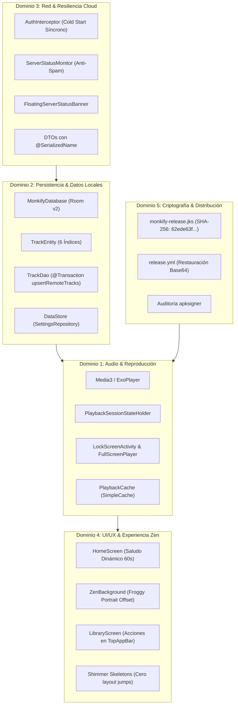

# SYSTEM MAP — Matriz de Capacidades, Invariantes y Mapeo del Proyecto

**Proyecto:** Monkify Android  
**Versión Base:** v0.4.7 (versionCode 8)  
**Última Actualización:** 2026-11-05  
**Propósito:** Este documento es el inventario central y la fuente de verdad técnica de las capacidades operativas, invariantes arquitecturales y pruebas que garantizan la no-regresión de funcionalidades ante cualquier cambio futuro en el código.

---

## 1. Reglas de Invarianza (Cómo usar este mapa)

1. **Consulta Obligatoria en Fase 0:** Antes de planificar cualquier requerimiento o refactorización, el planificador debe consultar este documento e identificar qué dominios e invariantes son potencialmente impactados.
2. **Prohibición de Supresión Silenciosa (*No Silent Drops*):** Ningún agente ni desarrollador puede eliminar componentes, campos de datos, DAOs, endpoints ni opciones de UI documentadas aquí sin autorización explícita del usuario en el alcance de la tarea.
3. **Mapeo en Código:** Los invariantes críticos documentados aquí se custodian mediante tests automatizados en `app/src/test/` y marcadores semánticos en código (`// INVARIANT: ...`).

---

## 2. Matriz de Dominios y Capacidades Operativas

---

### Dominio 1: Audio, Reproducción y Controles de Medios

| Capacidad / Feature | Componentes Clave | Invariantes No Negociables | Suite de Pruebas Asociada |
|---|---|---|---|
| **Sesión Global de Playback** | `PlaybackSessionStateHolder.kt`, `MonkifyPlaybackService.kt` | **INV-A01:** El estado y la cola de reproducción deben persistir como singleton en memoria; no se vacían al cambiar de pestaña ni al pasar a background. | `PlayerViewModelTest.kt` |
| **Reproductor Pantalla Completa & Letras** | `FullScreenPlayer.kt`, `LyricsView.kt` | **INV-A02:** El slider de reproducción debe actualizarse aislado a 1Hz sin recomponer toda la pantalla. Soporte dual de letras (`.lrc` sincronizadas y texto plano con scroll). | Inspección visual UI / Preview |
| **Superposición en Pantalla de Bloqueo** | `LockScreenActivity.kt` | **INV-A03:** Debe responder de inmediato al primer bloqueo mediante flags `FLAG_SHOW_WHEN_LOCKED` y `FLAG_TURN_SCREEN_ON` sin exigir desbloqueo del PIN para pausar/saltar pistas. | Verificación en dispositivo |
| **Caché Físico de Reproducción** | `PlaybackCache.kt`, `PlaybackModule.kt` | **INV-A04:** Conectado estrictamente a `SimpleCache` de Media3 con límite dinámico en MB y evicción limpia por `removeResource(...)` (prohibido `deleteRecursively()` en caliente). | `PlaybackCacheTest.kt` |
| **Enrutamiento Físico de Salida** | `PlayerViewModel.kt`, `AudioDeviceHelper.kt` | **INV-A05:** Enrutamiento efectivo mediante `AudioDeviceInfo` (altavoz, auriculares, Bluetooth) sin fallbacks placebo. | Verificación manual de audio |

---

### Dominio 2: Persistencia de Datos y Modelo Local

| Capacidad / Feature | Componentes Clave | Invariantes No Negociables | Suite de Pruebas Asociada |
|---|---|---|---|
| **Preservación de Estado de Usuario** | `TrackDao.kt`, `MonkifyDatabase.kt` | **INV-D01:** `@Transaction upsertRemoteTracks` NUNCA debe sobreescribir `isFavorite`, `isDownloaded`, `localFilePath`, `playCount` ni `lastPlayedAt` al sincronizar catálogo remoto. | `TrackDaoTest.kt` |
| **Optimización de Índices Room** | `TrackEntity.kt` | **INV-D02:** Mantener los 6 índices `@Index` (`isFavorite`, `isDownloaded`, `addedAt`, `lastPlayedAt`, `playCount`, `album`) para garantizar búsquedas y ordenamientos en $<10\text{ms}$. | Compilación KSP / Migración |
| **Integridad de Esquema Room** | `DatabaseMigrations.kt`, `DatabaseModule.kt` | **INV-D03:** Prohibido `fallbackToDestructiveMigration`. Toda alteración de tabla requiere una migración numerada (ej. `MIGRATION_1_2`) validada. | Pruebas de migración Room |
| **Configuración y Preferencias** | `SettingsRepository.kt`, `SettingsDataStore.kt` | **INV-D04:** Las preferencias del usuario (token, servidor, escenario Zen, volumen) persisten en DataStore con snapshot en memoria para lecturas instantáneas. | `SettingsRepositoryTest.kt` |

---

### Dominio 3: Conectividad, API Remota y Resiliencia

| Capacidad / Feature | Componentes Clave | Invariantes No Negociables | Suite de Pruebas Asociada |
|---|---|---|---|
| **Autenticación Síncrona en Frío** | `AuthInterceptor.kt`, `NetworkModule.kt` | **INV-N01:** En el arranque en frío (cold start), el interceptor debe obtener el token síncronamente vía `getServerAccessTokenImmediate()` evitando peticiones iniciales huérfanas o con 401 falso. | `AuthInterceptorTest.kt` |
| **Validación de Host de Confianza** | `AuthInterceptor.kt`, `PlayerViewModel.kt` | **INV-N02:** Solo hosts que terminen con `.monkify.workers.dev` reciben credenciales Bearer; no filtrar tokens a endpoints externos (ej. LRCLIB o CDNs). | `SecurityHostValidationTest.kt` |
| **Monitor de Servidor Anti-Spam** | `ServerStatusMonitor.kt`, `FloatingServerStatusBanner.kt` | **INV-N03:** Cero avisos visuales durante navegación normal saludable. Intervención exclusiva ante HTTP 401, error de red o tras reconexión exitosa. | `ServerStatusMonitorTest.kt` |
| **Blindaje R8 en DTOs** | `app/proguard-rules.pro`, `Models.kt` | **INV-N04:** Todo DTO de red debe tener `@SerializedName` en el 100% de sus campos para evitar inlining o stripping en builds Release. | `DtoSerializationContractTest.kt` |

---

### Dominio 4: Experiencia Zen, UI/UX y Ergonomía

| Capacidad / Feature | Componentes Clave | Invariantes No Negociables | Suite de Pruebas Asociada |
|---|---|---|---|
| **Encuadre Vertical de Froggy Web** | `ZenBackground.kt` | **INV-U01:** Viewport portrait gobernado por `@media (orientation: portrait) { #flutter-container { left: -12vw; width: 124vw; } }`. Centra la composición 16:9 en pantallas 20:9 sin bandas negras ni recortes de ranita. | Reality Checker / Captura |
| **Resiliencia Offline Zen** | `ZenBackground.kt`, `R.drawable.zen_froggy_preview` | **INV-U02:** Ante falla de red o carga web lenta, conmutar fluidamente al fondo estático WebP local sin pantallas en blanco. | Verificación modo avión |
| **Saludo Dinámico por Horario** | `ZenPhraseCatalog.kt`, `HomeViewModel.kt` | **INV-U03:** Conmutación determinista de 3 franjas horarias (6-11h "Buenos días", 12-19h "Buenas tardes", 20-5h "Buenas noches"), con inyección de `hourProvider` y ticker de 60s. | `ZenTimeOfDayTest.kt` |
| **Acciones por Lote en Biblioteca** | `LibraryScreen.kt`, `LibraryTopAppBar.kt` | **INV-U04:** Al activar modo selección, las acciones de lote (Favoritos, Descargar, Eliminar) se anclan en la barra superior `TopAppBar` dejando el scroll libre. | Compose Preview / Reality Checker |
| **Skeletons Shimmer Antirrebote** | `ShimmerSkeleton.kt`, `HomeScreen.kt` | **INV-U05:** Durante carga de catálogo remoto se muestran esqueletos metálicos nativos, eliminando rebotes visuales abruptos hacia el botón de prueba. | Reality Checker / Compose Preview |

---

### Dominio 5: Criptografía, Firma y Despliegue CI/CD

| Capacidad / Feature | Componentes Clave | Invariantes No Negociables | Suite de Pruebas Asociada |
|---|---|---|---|
| **Inmutabilidad del Certificado** | `monkify-release.jks`, `app/build.gradle.kts` | **INV-C01:** Firma Scheme v2 oficial permanente: `SHA-256: 62ede63ffb1e550f868e76000252f64e33940845385b6d307e342667aa744b5f`. Prohibido cambiar o rotar el alias o clave sin migración criptográfica formal. | `apksigner verify --verbose` |
| **Cero Fallbacks Efímeros en CI** | `.github/workflows/release.yml` | **INV-C02:** Si el secreto `RELEASE_KEYSTORE_BASE64` falta o está vacío, el job de release DEBE abortar con `exit 1`. Terminantemente prohibido `keytool -genkey` en CI. | Auditoría de workflow de release |
| **Resolución Multicamino de Almacén** | `app/build.gradle.kts` | **INV-C03:** Búsqueda compatible con rutas locales y relativas de subproyecto (`rootProject.file` y `file`) para `KEYSTORE_PATH`. | `./gradlew assembleRelease` |

---

## 3. Protocolo de Incorporación de Nuevos Cambios

Al iniciar cualquier tarea de desarrollo:
1. **Paso 1 (Lectura):** Revisar la sección correspondiente de este `SYSTEM_MAP.md`.
2. **Paso 2 (Contrato de No-Regresión):** En `spec.md`, listar explícitamente cuáles de los invariantes arriba listados (`INV-A01` a `INV-C03`) conviven con el nuevo cambio y verificar que ninguno resulte afectado.
3. **Paso 3 (Actualización Continua):** Si el nuevo requerimiento introduce una capacidad inédita, agregarla a este mapa antes del cierre de fase (`/close-phase`).
