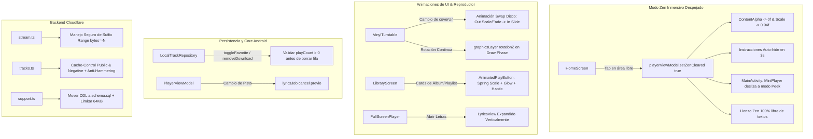

# Plan Arquitectónico: Auditoría y Afinamiento Integral v0.4.1 (Revisado)

## 1. Arquitectura de Componentes y Flujos de Interacción



---

## 2. Especificación Técnica de los Nuevos Componentes UI

### 2.1. Modo Zen Despejado y Barra Peek Inferior
En [`MainActivity.kt`](file:///e:/PG/vcp-s/Monkify-Android-Refine/app/src/main/java/com/k11000/monkify/MainActivity.kt):
- Se recolecta `val isZenCleared by playerViewModel.isZenCleared.collectAsState()`.
- Cuando `isZenCleared && !showFullScreenPlayer`:
  - `BottomNavBar` se retrae con `slideOutVertically { it }`.
  - `MiniPlayer` se traslada verticalmente con `slideOutVertically { it - 18.dp.roundToPx() }` (o `animateIntOffsetAsState`), mostrando una barra asomada de 18dp con una pequeña manija o indicador discreto (`Box` redondeado de 4dp de alto).
  - Tocar la barra asomada o realizar doble toque en la pantalla de inicio restaura `playerViewModel.setZenCleared(false)`.

En [`HomeScreen.kt`](file:///e:/PG/vcp-s/Monkify-Android-Refine/app/src/main/java/com/k11000/monkify/ui/screens/HomeScreen.kt):
- En `ZenGestureOverlay`:
  - Se eliminan por completo los `Text(currentTitle)` y `Text(currentArtist)`.
  - La píldora superior (`Modo Zen • Toca para volver`) y el texto de gestos inferior se controlan mediante un estado `var showInstructions by remember { mutableStateOf(true) }`.
  - Un `LaunchedEffect(Unit)` ejecuta `delay(3000); showInstructions = false`.
  - Ambos elementos se renderizan dentro de `AnimatedVisibility(visible = showInstructions, enter = fadeIn(), exit = fadeOut(tween(600)))`.

### 2.2. Transición Cinemática de Cambio de Vinilo
En [`VinylTurntable.kt`](file:///e:/PG/vcp-s/Monkify-Android-Refine/app/src/main/java/com/k11000/monkify/ui/components/VinylTurntable.kt):
- Se encapsula el cuerpo del disco de acetato (cuerpo + surcos + carátula central) dentro de un `AnimatedContent(targetState = coverUrl, transitionSpec = { ... })`:
  - **Salida del disco previo:** `slideOutHorizontally(targetOffsetX = { -it / 2 }, animationSpec = tween(400, easing = FastOutLinearInEasing)) + fadeOut(tween(300)) + scaleOut(targetScale = 0.85f)`
  - **Entrada del nuevo disco:** `slideInHorizontally(initialOffsetX = { it / 2 }, animationSpec = tween(500, easing = LinearOutSlowInEasing)) + fadeIn(tween(400)) + scaleIn(initialScale = 0.85f)`
- La rotación continua se ejecuta sobre `Modifier.graphicsLayer { rotationZ = rotationAnim.value % 360f }`, garantizando 0 recomposiciones a 60 FPS.

### 2.3. Microinteracción del Botón de Play en la Biblioteca
En [`LibraryScreen.kt`](file:///e:/PG/vcp-s/Monkify-Android-Refine/app/src/main/java/com/k11000/monkify/ui/screens/LibraryScreen.kt):
- Se introduce el componente reusable `AnimatedPlayButton`:
  ```kotlin
  @Composable
  fun AnimatedPlayButton(
      onClick: () -> Unit,
      modifier: Modifier = Modifier,
      isPlaying: Boolean = false,
      size: Dp = 38.dp
  )
  ```
  - Contenedor circular con `MonkifyPrimary` (o `Surface` con tinte azul translúcido).
  - Animación de escala elástica con `rememberCoroutineScope` o `Animatable` (escala 0.88f al presionar y rebote suave a 1.0f con `spring`).
  - Si la playlist o álbum está actualmente reproduciéndose, se muestra el icono `Icons.Default.Pause` o un indicador activo de ecualizador.

---

## 3. Lógica de Persistencia en Room (`LocalTrackRepository.kt`)

```kotlin
// toggleFavorite
val existing = trackDao.getTrackById(track.id)
if (existing != null) {
    val newFav = !existing.isFavorite
    val hasHistory = existing.playCount > 0 || existing.lastPlayedAt > 0L
    if (!newFav && !existing.isDownloaded && !hasHistory) {
        trackDao.deleteTrackById(track.id)
    } else {
        trackDao.insertTrack(existing.copy(isFavorite = newFav))
    }
}

// removeDownload
val existing = trackDao.getTrackById(trackId)
if (existing != null) {
    val hasHistory = existing.playCount > 0 || existing.lastPlayedAt > 0L
    if (!existing.isFavorite && !hasHistory) {
        trackDao.deleteTrackById(trackId)
    } else {
        trackDao.insertTrack(existing.copy(isDownloaded = false))
    }
}
```

---

## 4. Correcciones en Backend Cloudflare Workers

1. **`schema.sql`:** Incorporar tabla `support_reports` con índices.
2. **`support.ts`:** Eliminar `CREATE TABLE` en runtime, verificar `Content-Length < 65536`, sanear cadenas y escapar ```` ``` ```` en diagnóstico.
3. **`stream.ts`:** Resolver `offset` y `length` para `range.suffix`, evitando malformaciones de `Content-Range`.
4. **`tracks.ts`:** Prevenir reintento hacia `/search` ante 429/5xx de LRCLIB; inyectar cabeceras `Cache-Control`.
