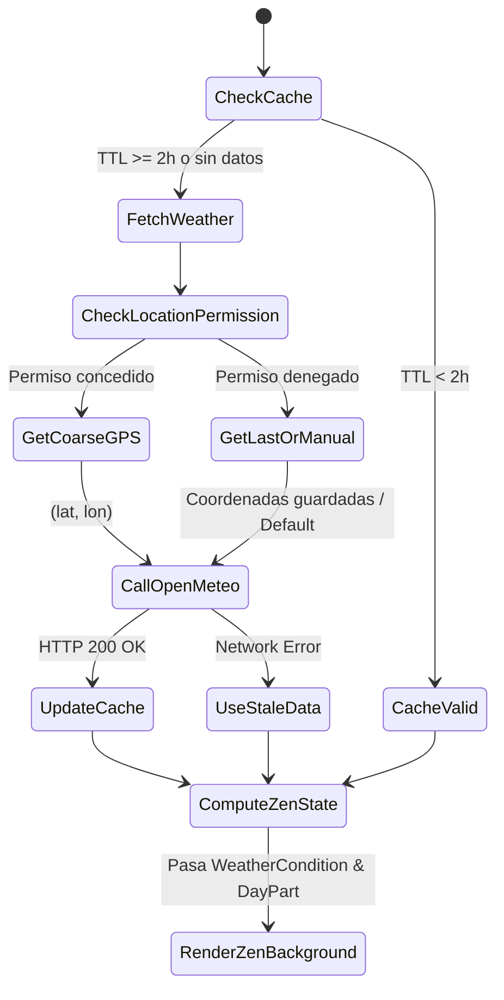

# Modelo de Datos: Módulo Clima & Rive para Monkify

**Feature:** `v043-rive-weather-zen`  
**Directorio:** `docs/specs/v043-rive-weather-zen/`

---

## 1. Entidades y Enumeraciones de Dominio

### 1.1 `WeatherCondition`
Define las 5 categorías climáticas universales mapeadas desde los códigos meteorológicos de la OMM (WMO):
```text
SUNNY:   Códigos 0, 1 (Despejado / Mayormente despejado)
CLOUDY:  Códigos 2, 3 (Parcialmente nublado / Cubierto)
HAZY:    Códigos 45, 48 (Niebla / Neblina con escarcha)
RAINY:   Códigos 51-67, 80-82, 95-99 (Llovizna, lluvia moderada, chubascos, tormentas eléctricas)
SNOWY:   Códigos 71-77, 85-86 (Nieve ligera, intensa, granizo)
```

### 1.2 `ZenDayPart`
Define la posición del ciclo circadiano calculada matemáticamente en relación al amanecer y atardecer:
* **`MORNING`:** Desde el amanecer (`sunrise`) hasta 2 horas y media después.
* **`DAY`:** Desde el final de la mañana hasta 1 hora antes de la puesta de sol (`sunset - 1h`).
* **`SUNSET`:** Desde 1 hora antes de la puesta de sol hasta 30 minutos después de ocultarse.
* **`NIGHT`:** Desde el fin del atardecer hasta el amanecer del día siguiente.
* *Fallback si no hay datos solares:* `06:00-09:00` (Morning), `09:00-17:00` (Day), `17:00-19:00` (Sunset), `19:00-06:00` (Night).

### 1.3 `ZenTheme`
Enumera los modos visuales ambientales seleccionables por el usuario:
* `FROGGY_WEATHER`: Fondo escénico reactivo al clima y hora en tiempo real con Froggy y partículas ambientales.
* `COSMOS_HD`: Galaxia espiral inclinada a -26°, nebulosas multicapa, 72 estrellas con picos de difracción y meteoros sinusoidales.
* `AURORA_PROCEDURAL`: Luces del norte generativas con ondas sinusoidales armónicas de color esmeralda y violeta.

### 1.4 `FroggyScene`
Temas escénicos para la rana del clima:
* `FIELDS`: Praderas abiertas con flores silvestres y colinas en el horizonte.
* `HILL`: Colina solitaria con árbol frondoso y vista panorámica.
* `MUSHROOM`: Bosque místico con setas gigantes y vegetación densa.

---

## 2. Diagrama de Transición de Estados



---

## 3. Estado de la Vista: `ZenVisualizerState`

```kotlin
data class ZenVisualizerState(
    val activeTheme: ZenTheme = ZenTheme.FROGGY_WEATHER,
    val froggyScene: FroggyScene = FroggyScene.FIELDS,
    val weatherCondition: WeatherCondition = WeatherCondition.SUNNY,
    val dayPart: ZenDayPart = ZenDayPart.DAY,
    val temperatureCelsius: Float = 22f,
    val temperatureRange: String = "↑25° ↓14°",
    val locationName: String = "Ubicación actual",
    val isPlaying: Boolean = false,
    val isBuffering: Boolean = false,
    val isWeatherStale: Boolean = false
)
```
