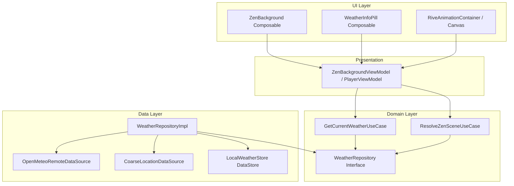

# Plan de Implementación y Arquitectura: Módulo Rive y Clima en Tiempo Real

**Feature:** `v043-rive-weather-zen`  
**Directorio:** `docs/specs/v043-rive-weather-zen/`  
**Fecha:** 2026-10-27  
**Estado:** Fase 0 — Especificación y Arquitectura

---

## 1. Contexto Técnico y Dependencias

### 1.1 Stack Tecnológico
* **Lenguaje:** Kotlin 2.0+
* **Framework UI:** Jetpack Compose + Compose Foundation
* **Motor de Animación Vectorial:** Rive Runtime para Android (`app.rive:rive-android:11.2.1`)
* **Ubicación de Bajo Consumo:** Google Play Services Location (`com.google.android.gms:play-services-location:21.3.0`)
* **Cliente HTTP & Deserialización:** OkHttp / Retrofit con Kotlinx Serialization / Gson (reutilizando la infraestructura existente en `Monkify`)
* **Persistencia Local:** DataStore / SharedPreferences / Room

---

## 2. Arquitectura Modular

---

## 3. Manejo de Fallos y Resiliencia de Red

1. **Fallo de Conexión HTTP (Timeout / No Internet):**
   - El repositorio captura `IOException` o `SocketTimeoutException`.
   - Si la caché local tiene datos previos, se entregan con la bandera `isWeatherStale = true`.
   - Si no existen datos previos en caché, se genera un `CurrentWeather` sintético basado en la hora local del dispositivo (Amanecer 06:30, Atardecer 19:30, condición `SUNNY` por defecto).
2. **Permisos de Ubicación Denegados:**
   - La llamada a `LocationDataSource` retorna `Result.failure(PermissionDeniedException)`.
   - Se consulta la ciudad guardada por defecto en preferencias (ej. Buenos Aires, Madrid o Ciudad de México).
   - Se realiza la llamada a Open-Meteo con las coordenadas de la ciudad de respaldo.
3. **Fallo en Renderizado Rive o Archivos `.riv` Inexistentes:**
   - Si el archivo `.riv` no se encuentra o el runtime nativo falla en inicializar, el contenedor conmuta de forma transparente y sin error al motor procedural de Compose Canvas (`ZenBackground.kt`) previamente verificado en v0.4.2.

---

## 4. Auditoría de Principios de Gobernanza y Constitución

* [x] **Principio I — Calidad y Verificación Empírica:** Pruebas unitarias obligatorias para el mapeo de códigos WMO, cálculo de franjas horarias y caché con TTL antes de tocar la UI.
* [x] **Principio II — Cero Suposiciones:** No se asumirá que la respuesta de Open-Meteo es estática; se cubrirán respuestas nulas, intervalos atípicos y respuestas vacías.
* [x] **Principio III — Verificación Visual Obligatoria de UI:** Toda composición visual y fondo escénico debe comprobarse visualmente mediante Previews de Compose (`@Preview`) y simulación interactiva antes de dar por cerrada la tarea.
* [x] **Principio IV — Cambio Mínimo Quirúrgico:** No se tocan archivos de lógica de reproducción de audio ni se altera el reproductor base; la integración se aísla en el subsistema Zen y el nuevo repositorio meteorológico.
* [x] **Principio V — Privacidad y Fuga Cero:** Prohibido el uso de claves secretas o tracking invasivo; la ubicación solo se lee a nivel de celda/ciudad aproximada.

---

## 5. Compuerta de Planificación (Gate)
Este plan define las interfaces, contratos y manejo de errores. Tras la generación de `tasks.md`, el agente se detendrá obligatoriamente para solicitar la confirmación del usuario antes de implementar cualquier código fuente.
