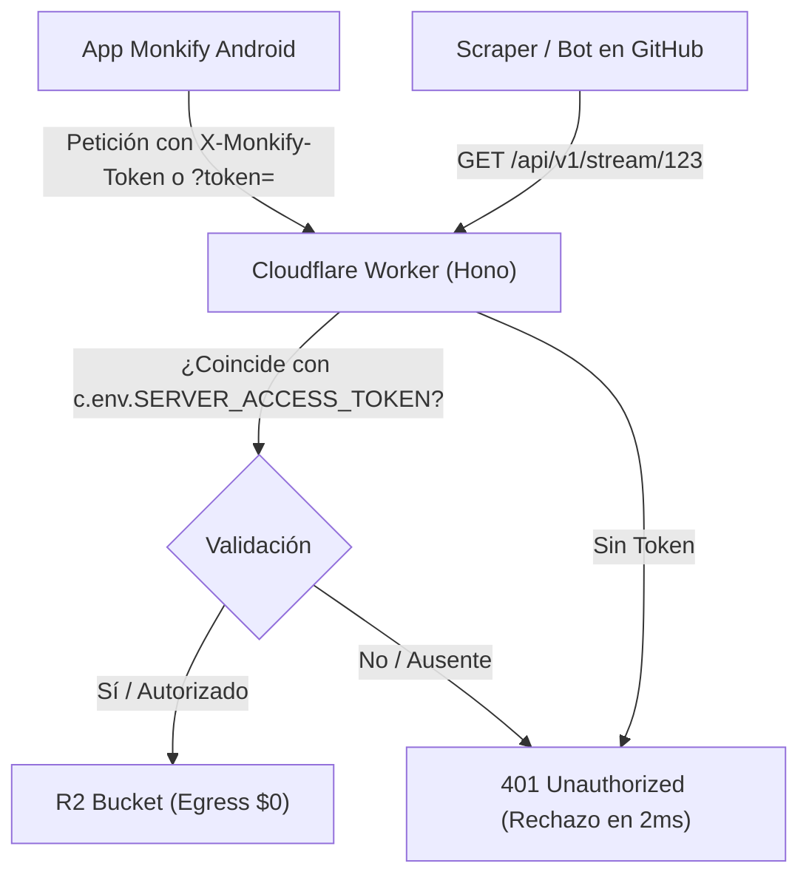

# Plan de Arquitectura y Diseño Técnico: v0.4.5 Hardening y Protección de Servidor

## 1. Arquitectura de Autenticación de Servidor y Streaming Privado

### 1.1 Flujo de Protección de Streaming y Cuota


### 1.2 Almacenamiento Seguro en Android (`SettingsRepository`)
- En `SettingsRepository`:
  - `val serverAccessToken: Flow<String>` mapeado a `KEY_SERVER_ACCESS_TOKEN`.
  - `suspend fun setServerAccessToken(token: String)`.
- En `AuthInterceptor`:
  - Lee el token configurado y valida el host:
  ```kotlin
  internal fun isTrustedMonkifyHost(host: String): Boolean {
      return host.endsWith("monkify.workers.dev") ||
             host.endsWith("monkify.tudominio.com") ||
             host == "10.0.2.2" ||
             host == "localhost" ||
             host == "127.0.0.1"
  }
  ```
  - Si es host confiable y hay token: inyecta `X-Monkify-Token: <token>` y `Authorization: Bearer <token>`.
  - Si es host público (Open-Meteo, GitHub): no añade cabecera alguna.

### 1.3 Audio Streaming con Token en ExoPlayer
- Cuando `PlaybackCache` o `PlayerViewModel` construyen la URI del stream:
  - `val streamUrl = if (token.isNotBlank()) "$baseUrl/stream/$trackId?token=$token" else "$baseUrl/stream/$trackId"`
  - Esto garantiza compatibilidad nativa con `ExoPlayer` y `Media3` sin necesidad de interceptores complejos de bytes a nivel de ExoPlayer DataSource.

### 1.4 Middleware en Cloudflare Worker (`cloudflare-backend/src/index.ts`)
```typescript
app.use('/api/v1/*', async (c, next) => {
  if (c.req.method === 'OPTIONS' || c.req.path.startsWith('/health')) {
    return next()
  }

  const expectedToken = c.env.SERVER_ACCESS_TOKEN
  if (expectedToken) {
    const authHeader = c.req.header('Authorization')
    const customHeader = c.req.header('X-Monkify-Token')
    const queryToken = c.req.query('token')
    const bearer = authHeader?.startsWith('Bearer ') ? authHeader.slice(7) : null
    const providedToken = customHeader || bearer || queryToken

    if (!providedToken || providedToken !== expectedToken) {
      return c.json(
        { error: 'Unauthorized', detail: 'Token de acceso al servidor inválido o ausente' },
        401
      )
    }
  }

  await next()
})
```

---

## 2. Hardening Local Android (R8, ProGuard, Permisos)

### 2.1 Directivas de ProGuard (`app/proguard-rules.pro`)
- Reglas completas para:
  - **Gson**: Conservación de `@SerializedName` y clases DTO en `com.k11000.monkify.data.remote.dto.**`.
  - **Room**: Conservación de `@Entity`, `@Dao` y `RoomDatabase`.
  - **Retrofit & OkHttp**: Conservación de interfaces API y anotaciones HTTP.
  - **Media3 & ExoPlayer**: Conservación de reproductores, codecs y servicios de sesión.
  - **Rive Runtime**: Conservación de clases nativas JNI y métodos `native`.
  - **Compose**: Conservación de `@Composable` y lambdas de UI.

### 2.2 Configuración Gradle (`app/build.gradle.kts`)
- `isMinifyEnabled = true`
- `isShrinkResources = true`
- `proguardFiles(getDefaultProguardFile("proguard-android-optimize.txt"), "proguard-rules.pro")`

### 2.3 Manifiesto y Respaldo
- Eliminar `REQUEST_INSTALL_PACKAGES`.
- En `backup_rules.xml` y `data_extraction_rules.xml`, excluir `sharedpref` y `database` para que no se filtren credenciales por depuración `adb backup`.
