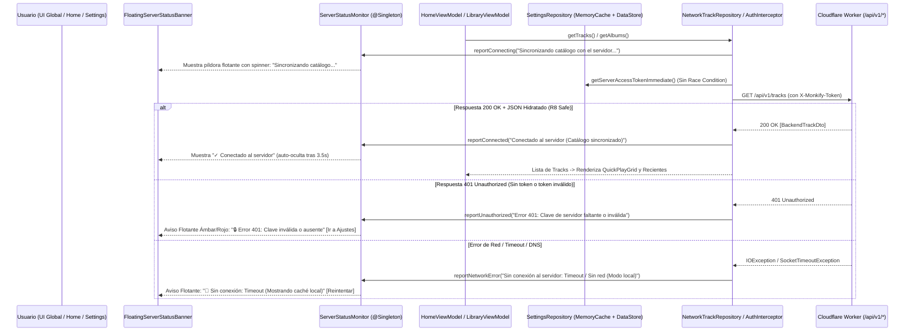

# Plan Técnico y Arquitectura: v0.4.6 Recuperación de Producción, Aviso Flotante Global y Estados de Carga

## 1. Diagrama del Flujo Reparado y Aviso Flotante Reactivo (End-to-End)



---

## 2. Contratos y Cambios Modulares

### 2.1 Blindaje de DTOs frente a R8 (`app/proguard-rules.pro` & `Models.kt`)
- **Problema:** R8 eliminó las propiedades de `BackendTrackDto` porque la regla en `proguard-rules.pro` apuntaba a `com.k11000.monkify.data.remote.model.**` (paquete inexistente) y `BackendTrackDto` tenía propiedades sin `@SerializedName`.
- **Solución:**
  1. En `app/proguard-rules.pro`:
     ```proguard
     -keep class com.k11000.monkify.data.remote.dto.** { *; }
     -keep class com.k11000.monkify.domain.model.** { *; }
     ```
  2. En `Models.kt`, anotar todos los campos de `BackendTrackDto`, `TrackDto`, `PlaylistSummaryDto`, `CreatePlaylistRequest`, `AddTrackToPlaylistRequest`, `ActionResponseDto`, `IngestRequest`, `IngestResponse`, `LyricsResponse`, `SupportReportRequestDto`, `SupportReportResponseDto` con `@SerializedName(...)` explícito.
  3. Crear `DtoSerializationContractTest.kt` para verificar por reflexión que ningún campo de `BackendTrackDto` ni de los demás DTOs carece de `@SerializedName`.

### 2.2 Monitor Global `ServerStatusMonitor` y Prevención de Race Condition (`SettingsRepository` & `NetworkModule`)
- Crear `app/src/main/java/com/k11000/monkify/data/remote/api/ServerStatusMonitor.kt` (`@Singleton`):
  ```kotlin
  sealed interface GlobalServerStatus {
      data object Idle : GlobalServerStatus
      data class Connecting(val message: String = "Conectando con el servidor...") : GlobalServerStatus
      data class Connected(val message: String = "Conectado al servidor", val timestamp: Long = System.currentTimeMillis()) : GlobalServerStatus
      data class Unauthorized(val reason: String = "Error 401: Clave de servidor ausente o inválida en Ajustes") : GlobalServerStatus
      data class Error(val reason: String) : GlobalServerStatus
  }
  ```
- En `SettingsRepository`:
  - Mantener `@Volatile private var cachedToken: String? = null`.
  - En `setServerAccessToken(token: String)`, actualizar `cachedToken = token.trim()` inmediatamente además de persistir en DataStore.
  - Exponer `fun getServerAccessTokenImmediate(): String` que devuelve `cachedToken` si ya fue cargado, o realiza una lectura inicial `runBlocking(Dispatchers.IO) { serverAccessToken.first() }` una única vez y almacena el valor en `cachedToken`.
- En `NetworkTrackRepository`:
  - Notificar a `ServerStatusMonitor` al iniciar peticiones principales (`reportConnecting`), al recibir respuesta satisfactoria (`reportConnected`) y al capturar `HttpException` (diferenciando `401`/`403` con `reportUnauthorized` del resto de códigos HTTP) o `IOException` (`reportError`), registrando siempre el detalle en `AppLogger`.

### 2.3 Aviso Flotante Global (`FloatingServerStatusBanner.kt`) e Interfaces de Carga (`HomeScreen`, `SettingsScreen`)
- Crear `app/src/main/java/com/k11000/monkify/ui/components/FloatingServerStatusBanner.kt`:
  - Componente Compose con `AnimatedVisibility` que observa `GlobalServerStatus`.
  - Muestra spinner durante `Connecting`, alerta accionable durante `Unauthorized` (con botón `"Configurar clave"` que navega a `Settings`) o `Error` (con botón `"Reintentar"`), y confirmación verde auto-descartable tras 3.5 segundos cuando pasa a `Connected`.
  - Incluye `@Preview` de Compose para los 4 estados (`Connecting`, `Unauthorized 401`, `NetworkError`, `Connected`) para validación visual empírica.
- Integrar `FloatingServerStatusBanner` en [`MainActivity.kt`](file:///e:/PG/vcp-s/Monkify-Android-Refine/app/src/main/java/com/k11000/monkify/MainActivity.kt) como overlay flotante superior con `statusBarsPadding()`, garantizando que sea visible desde cualquier pantalla.
- En [`HomeScreen.kt`](file:///e:/PG/vcp-s/Monkify-Android-Refine/app/src/main/java/com/k11000/monkify/ui/screens/HomeScreen.kt):
  - Cuando `isLoading == true` y `quickItems.isEmpty()`, mostrar un bloque de carga estilizado (`HomeLoadingPlaceholder` con indicador de progreso y mensaje `"Sincronizando catálogo con el servidor..."`) en vez del botón `"Play Test Track"`.
  - Cuando `isLoading == false` y `quickItems.isEmpty()`, mostrar tarjeta de estado con botón `"Reintentar sincronización"` además del modo de prueba.
- En [`SettingsViewModel.kt`](file:///e:/PG/vcp-s/Monkify-Android-Refine/app/src/main/java/com/k11000/monkify/ui/screens/viewmodel/SettingsViewModel.kt) y [`SettingsScreen.kt`](file:///e:/PG/vcp-s/Monkify-Android-Refine/app/src/main/java/com/k11000/monkify/ui/screens/SettingsScreen.kt):
  - Al pulsar `"Guardar"`, guardar el token y ejecutar verificación activa contra el servidor (`testServerConnection()`), mostrando el estado en la propia tarjeta de Ajustes y actualizando `ServerStatusMonitor`.
- En `HomeViewModel`, `LibraryViewModel` y `PlayerViewModel`:
  - Observar cambios en `settingsRepository.serverAccessToken` para recargar automáticamente el catálogo sin reiniciar la app, y detallar el error `HTTP 401` en el reproductor.

---

## 3. Reingeniería del Modo de Trabajo (Prevención de Regresiones en Producción)

1. **Auditoría R8 Post-Build Obligatoria (`R8 Contract Check`):**
   - Toda clase serializada por reflexión (Gson/Retrofit) está cubierta por `DtoSerializationContractTest` y se verifica contra `app/build/outputs/mapping/release/usage.txt` en `assembleRelease`.
2. **Prohibición de `catch (Exception) { emptyList() }` Mudo (`Zero Silent Catch & Visible Feedback Policy`):**
   - Ningún repositorio de red puede tragarse una excepción sin registrarla en `AppLogger.e(...)` y actualizar `ServerStatusMonitor` para que el usuario siempre tenga visibilidad en el aviso flotante.
3. **Prioridad en Estados de Carga y Diagnóstico de Red:**
   - Toda operación de red crítica para la pantalla debe reflejarse inmediatamente en un estado de carga visual (`Connecting` / skeleton) y terminar en un estado explícito (`Connected` o error detallado con causa y botón de acción).
