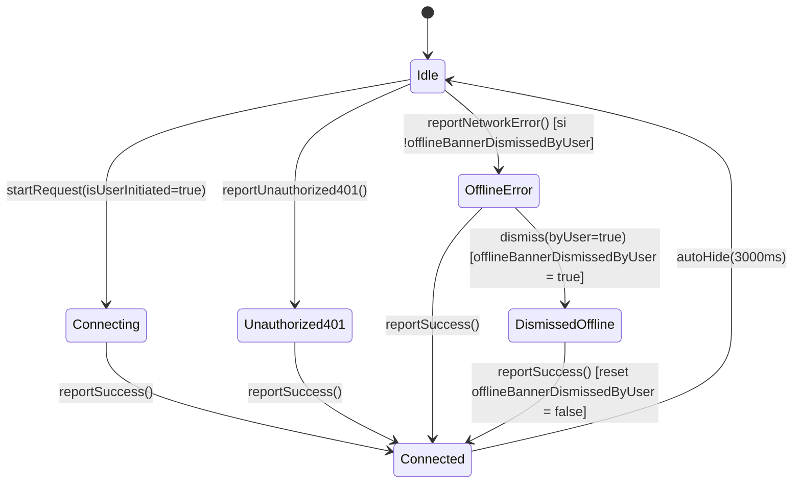

# Modelo de Datos y Contratos de Estado: Remediación Integral (`v0.4.7`)

**Feature:** `v047-comprehensive-audit-remediation`  
**Fecha:** 2026-10-30

---

## 1. Entidad Persistente: `TrackEntity` (Room SQLite)

Tabla: `favorite_tracks` (`MonkifyDatabase`, `exportSchema = true`)

### Índices Declarados (`@Index`)
- `Index(value = ["isFavorite"])`
- `Index(value = ["isDownloaded"])`
- `Index(value = ["addedAt"])`
- `Index(value = ["lastPlayedAt"])`
- `Index(value = ["playCount"])`
- `Index(value = ["album"])`

### Regla de Fusión No Destructiva (`upsertRemoteTracks`)
Cuando una pista remota `R` llega desde la API y ya existe una fila `L` con el mismo `id`:

| Campo | Valor Resultante | Origen |
|---|---|---|
| `id` | `R.id` | Clave primaria |
| `title`, `artist`, `album`, `durationMs`, `coverUrl` | `R.*` | Actualizado desde catálogo remoto |
| `streamUrl` | `R.streamUrl` | URL HTTP remota canónica (nunca sobrescrita por ruta local) |
| `isFavorite` | `L?.isFavorite ?: false` | **Preservado del estado local** |
| `isDownloaded` | `L?.isDownloaded ?: false` | **Preservado del estado local** |
| `localFilePath` | `L?.localFilePath` | **Preservado del estado local** |
| `addedAt` | `L?.addedAt ?: now` | **Preservado del estado local** |
| `playCount` | `L?.playCount ?: 0` | **Preservado del estado local** |
| `lastPlayedAt` | `L?.lastPlayedAt ?: 0L` | **Preservado del estado local** |

---

## 2. Preferencias y Estado del Modo Zen Climático (`SettingsRepository` & `LocalWeatherStore`)

### 2.1 Nuevas Claves en `SettingsRepository` (`monkify_settings`)
- `KEY_FROGGY_SCENERY = stringPreferencesKey("zen_froggy_scenery")`:
  - Valores admitidos: `"AUTO"` (rotación automática según día/sesión entre los 3 escenarios), `"FIELDS"` (Campos), `"HILL"` (Colina), `"MUSHROOM"` (Bosque de Hongos).
  - Valor por defecto: `"AUTO"` (haciendo accesibles los **60 fondos oficiales WebP** desde el primer momento, o permitiendo fijar cualquiera de los 3).

### 2.2 Persistencia de Ubicación Manual en `LocalWeatherStore`
- `KEY_MANUAL_LAT = floatPreferencesKey("manual_latitude")`
- `KEY_MANUAL_LON = floatPreferencesKey("manual_longitude")`
- `KEY_MANUAL_CITY = stringPreferencesKey("manual_city_name")`

---

## 3. Máquina de Estados Única de `ServerStatusMonitor`

- **Invariante de Instancia Única:** `ServerStatusMonitor` mantiene todas sus banderas (`needsRecoveryConfirmation`, `offlineBannerDismissedByUser`) en una única instancia `@Singleton` compartida entre Hilt y la UI.
